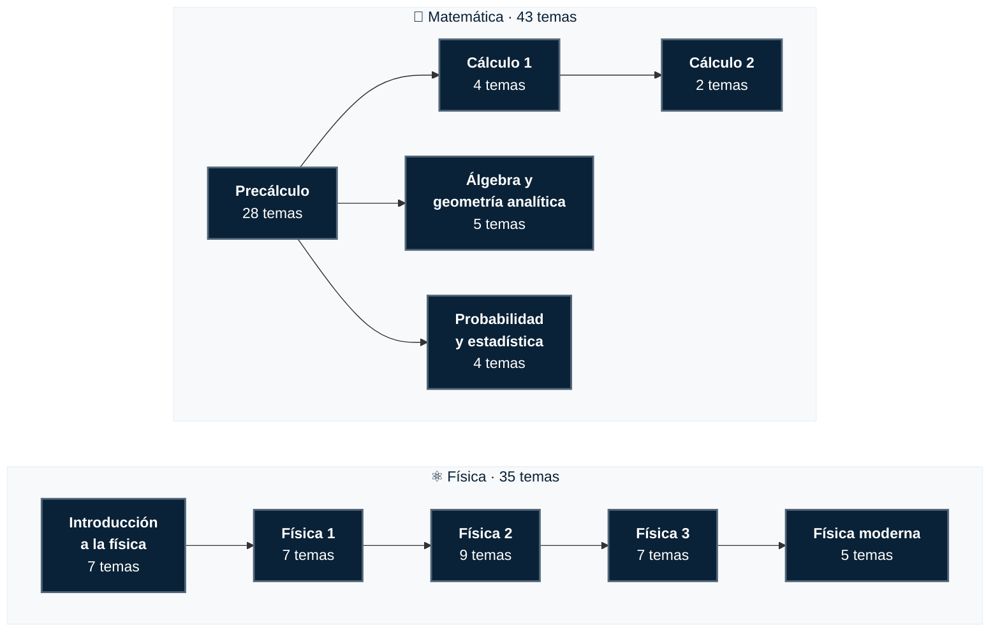
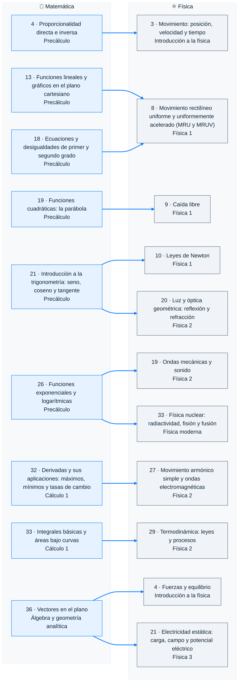
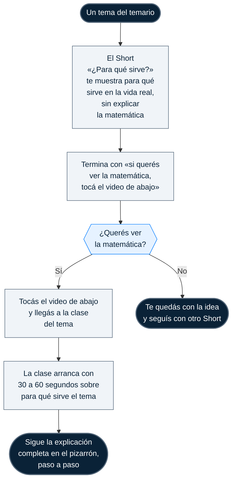
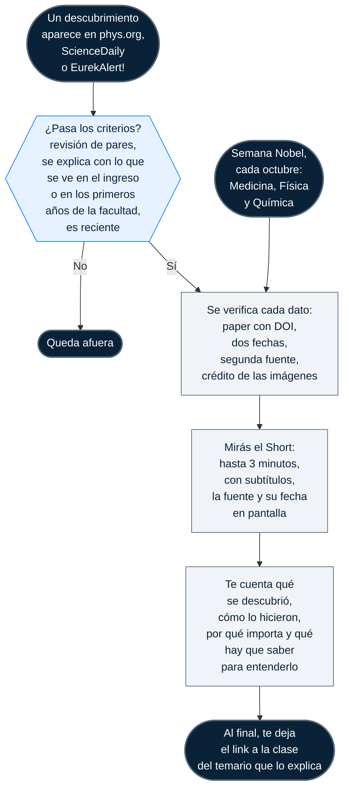

# 🗺️ Mapas

Cómo se ordenan los 78 temas por curso, cómo se conectan Matemática y Física, y cómo te llevan los Shorts hasta cada clase. El temario completo, con filtros y búsqueda, está en la [página](https://loiaconobruno.github.io/loiaAcademy/#temario) y en [data/temario.csv](data/temario.csv). Volvé al [inicio](README.md).

- [Recorrido por curso](#recorrido-por-curso)
- [Conexiones entre Matemática y Física](#conexiones-entre-matemática-y-física)
- [Qué matemática usan algunos temas de Física](#qué-matemática-usan-algunos-temas-de-física)
- [Flujo del Short «¿Para qué sirve?»](#flujo-del-short-para-qué-sirve)
- [Flujo de «Recién descubierto»](#flujo-de-recién-descubierto)

## Recorrido por curso

Los 78 temas, curso por curso: 43 de Matemática y 35 de Física.

## Conexiones entre Matemática y Física

Cada flecha une un tema de Matemática con el tema de Física que lo usa. El número es el del temario.

## Qué matemática usan algunos temas de Física

Si vas a ver uno de estos temas de Física, te conviene tener vista antes la clase de Matemática que usa.

| Tema de Física | Curso | Usa este tema de Matemática | Curso |
|---|---|---|---|
| 3 · Movimiento: posición, velocidad y tiempo | Introducción a la física | 4 · Proporcionalidad directa e inversa | Precálculo |
| 4 · Fuerzas y equilibrio | Introducción a la física | 36 · Vectores en el plano | Álgebra y geometría analítica |
| 8 · Movimiento rectilíneo uniforme y uniformemente acelerado (MRU y MRUV) | Física 1 | 13 · Funciones lineales y gráficos en el plano cartesiano | Precálculo |
| 8 · Movimiento rectilíneo uniforme y uniformemente acelerado (MRU y MRUV) | Física 1 | 18 · Ecuaciones y desigualdades de primer y segundo grado | Precálculo |
| 9 · Caída libre | Física 1 | 19 · Funciones cuadráticas: la parábola | Precálculo |
| 10 · Leyes de Newton | Física 1 | 21 · Introducción a la trigonometría: seno, coseno y tangente | Precálculo |
| 19 · Ondas mecánicas y sonido | Física 2 | 26 · Funciones exponenciales y logarítmicas | Precálculo |
| 20 · Luz y óptica geométrica: reflexión y refracción | Física 2 | 21 · Introducción a la trigonometría: seno, coseno y tangente | Precálculo |
| 21 · Electricidad estática: carga, campo y potencial eléctrico | Física 3 | 36 · Vectores en el plano | Álgebra y geometría analítica |
| 27 · Movimiento armónico simple y ondas electromagnéticas | Física 2 | 32 · Derivadas y sus aplicaciones: máximos, mínimos y tasas de cambio | Cálculo 1 |
| 29 · Termodinámica: leyes y procesos | Física 2 | 33 · Integrales básicas y áreas bajo curvas | Cálculo 1 |
| 33 · Física nuclear: radiactividad, fisión y fusión | Física moderna | 26 · Funciones exponenciales y logarítmicas | Precálculo |

## Flujo del Short «¿Para qué sirve?»

Un Short por cada tema del temario: muestra para qué sirve en la vida real y termina con «si querés ver la matemática, tocá el video de abajo». En el temario, **Para qué sirve** te adelanta de qué trata cada uno.

## Flujo de «Recién descubierto»

Cómo llega un descubrimiento a un Short, qué controles pasa antes y a qué clase del temario te lleva. Los criterios y la verificación, paso por paso, están en [shorts.md](shorts.md#recién-descubierto).

